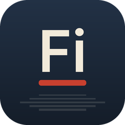

<p align="center">
  
</p>

<h1 align="center">Filme · Suíte FisiLab</h1>

<p align="center"><b>Editor de vídeo</b></p>

<p align="center">Alternativa livre ao <b>Adobe Premiere Pro</b></p>

<p align="center">
  Disponibilizado pelo <b>FisiLab — LARFIC · UFRGS</b> em parceria com o <b>CTA — Centro de
  Tecnologia Acadêmica</b>, para democratizar o acesso à tecnologia entre os alunos da UFRGS.
</p>

---

## O que faz

- **Edição não linear completa:** edição em três pontos (inserir, sobrescrever, levantar e extrair),
  ferramentas de ripple, roll, slip, slide, alongamento de velocidade e navalha, Trim Monitor e
  aparo dinâmico durante a reprodução.
- **Tempo exato:** toda edição é calculada em ticks inteiros, então 23,976, 29,97 drop-frame e
  59,94 quadros/s são exatos; salvamento atômico, auto-salvamento e recuperação após falhas.
- **Correção de cor (Lumetri):** correção básica, looks criativos, curvas, rodas de cor, HSL
  secundário e vinheta, com escopos de vídeo.
- **Efeitos e movimento:** cerca de 90 efeitos de vídeo e 30 transições, movimento e opacidade em
  todo clipe, 26 modos de mesclagem e quadros-chave com curvas de valor e velocidade, num
  compositor de GPU (wgpu) que trabalha em luz linear.
- **Áudio:** medidores de loudness (ITU-R BS.1770 / EBU R128), EQ, dinâmica, limitador, reverb,
  redução de ruído, mixer de faixas e de clipes com automação.
- **Títulos e legendas:** motor de texto próprio, ferramentas de texto, forma e caneta no monitor,
  faixas de legenda (SRT, WebVTT, SCC) e gravação das legendas no vídeo.
- **Formatos e exportação:** decodificadores próprios em Rust (H.264, HEVC, ProRes, AAC e outros),
  exportação para H.264 MP4, ProRes, MXF, PNG, GIF e WAV, em segundo plano.
- **Intercâmbio:** Final Cut Pro 7 XML, FCPXML, OpenTimelineIO, EDL CMX 3600, AAF e OMF.

## Instalação

### Windows

Baixe o instalador `FisiLab-Filme-Setup-<versão>.exe` no portal de downloads da
[Suíte FisiLab](https://github.com/mrcandrade/larfic/tree/main/suite-fisilab) ou nas
[Releases do GitHub](https://github.com/mrcandrade/fisilab-filme/releases) e execute-o.

### Compilar a partir do código

É preciso ter o [Rust](https://rustup.rs) instalado (no Windows, com as Build Tools do MSVC).

```sh
git clone https://github.com/mrcandrade/fisilab-filme
cd fisilab-filme
cargo run --release -p filmcraft                     # o aplicativo (fisilab-filme), com um projeto de demonstração
cargo run --release -p filmcraft-cli -- commands     # a linha de comando (fisilab-filme-cli)
```

Os executáveis gerados ficam em `target/release/fisilab-filme(.exe)` e
`target/release/fisilab-filme-cli(.exe)`.

## Créditos

O Filme é uma versão modificada do [FilmCraft](https://github.com/storytold/filmcraft), criado
pelo ArtCraft Team e contribuidores. Todo o trabalho de edição, codecs, formatos e ferramentas vem
do projeto original. O código é distribuído sob a licença MIT ou Apache 2.0, à sua escolha
([LICENSE-MIT](LICENSE-MIT), [LICENSE-APACHE](LICENSE-APACHE)). Veja também [NOTICE](NOTICE),
[ATTRIBUTION.md](ATTRIBUTION.md), [MODIFICACOES.md](MODIFICACOES.md) (o que mudou nesta versão) e o
[README original](README.upstream.md).

Os nomes e marcas do projeto original pertencem aos seus titulares; esta versão não é afiliada nem
endossada por eles.

## Manifesto

Conhecimento produzido numa universidade pública deve circular livremente, e as ferramentas que
usamos para ensinar, pesquisar e criar também: leia o
[Manifesto pelas tecnologias livres](https://github.com/mrcandrade/larfic/blob/main/suite-fisilab/MANIFESTO.md).

---

<p align="center">
  <a href="https://www.ufrgs.br"></a>
  &nbsp;&nbsp;
  <a href="https://cta.if.ufrgs.br"></a>
  &nbsp;&nbsp;
  
</p>
